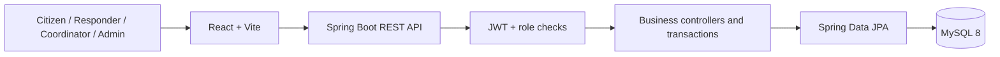

# Local Emergency Resource Coordination System (LERCS)

LERCS is a role based web application for local coordination of emergency reports, responders, supplies, shelters, hospitals, and community announcements. It supports information management and does not replace official emergency services.

## Features

- Citizen registration, sign in, JWT sessions, and role aware navigation.
- Emergency reporting with category, priority, affected people, address, coordinates, and requested help.
- Incident status history and coordinator assignment workflow.
- Coordinator workspace for status transitions, verified responder dispatch, resource allocation/returns, facility updates, and announcements.
- Responder profiles, skills, verification state, availability, and assignment acceptance/status updates.
- Administrator workspace for account role/activation management, categories, and audit history.
- Resource inventory with transactional assignment and return quantity accounting.
- Shelter capacity and hospital bed availability safeguards.
- Interactive incident and facility maps with OpenStreetMap tiles and location markers when coordinates are present.
- Internal notifications, announcements, and audit events.
- Search, pageable REST lists, dashboard counts, OpenAPI/Swagger, image evidence upload validation, and responsive interface.
- MySQL 8 deployment through Docker Compose; H2 file database for a quick local start.

## Technology stack

Java 21, Spring Boot 3.4, Spring Web, Spring Data JPA, Spring Security, JWT (jjwt), Hibernate, Bean Validation, Maven, MySQL 8, H2 development fallback, React, Vite, React Router, Axios, Recharts, and Docker Compose.

## Architecture

The Vite React client calls a stateless REST API. Spring Security validates bearer JWTs; controllers invoke JPA-backed services/repositories and MySQL stores application records. The source keeps related backend components together in `com.lercs` to make this college project easier to follow; DTO request records and the repository layer define the API/database boundaries.



## Project structure

```text
lercs/
├── backend/       Spring Boot API, JPA domain, security, tests
├── frontend/      React/Vite responsive client and UI test
├── docs/          College project documentation and diagrams
├── docker-compose.yml
└── .env.example
```

Database tables include `users`, `emergency_categories`, `emergencies`, `emergency_status_history`, `responder_profiles`, `responder_assignments`, `resources`, `resource_assignments`, `shelters`, `hospitals`, `notifications`, `announcements`, and `audit_logs`. Hibernate creates/updates the schema for the development setup; set `DDL_AUTO=validate` after managing migrations for a production deployment.

## Requirements

- Java 21 and Maven 3.9+
- Node.js 20+ and npm
- MySQL 8+ for a standalone persistent deployment
- Docker Desktop (optional, for Compose)

## Run with Docker Compose

1. Copy `.env.example` to `.env` and replace every development secret/password.
2. To create development seed accounts and sample incident/announcement data, set `LERCS_SEED_PASSWORD` to a strong local-only password before the first start. The seed creates `admin@lercs.local`, `coordinator@lercs.local`, `responder@lercs.local`, and `citizen@lercs.local` with that password. The seeded responder is verified and available for assignment demonstrations. Do not use this mechanism for real deployments.
3. From this directory run `docker compose up --build`.
4. Open <http://localhost:5173>. Swagger UI is at <http://localhost:8080/swagger-ui.html> (or `/swagger-ui/index.html` through the frontend proxy).

Compose defaults are for local development only. It exposes the backend on port 8080 for Swagger and routes app requests through the frontend proxy.

## Local backend

With no database variables, the backend stores development data in a local H2 file. From `backend/`, run:

```sh
mvn spring-boot:run
```

To use MySQL, create database `emergency_resource_coordination`, export `DB_URL`, `DB_USERNAME`, `DB_PASSWORD`, and `DB_DRIVER=com.mysql.cj.jdbc.Driver`, then run the same command. Export a long random `JWT_SECRET`; its built-in value is only a local development fallback. `LERCS_SEED_PASSWORD` enables seed accounts only when there are no users in the database.

## Local frontend

In a second terminal, from `frontend/`:

```sh
npm install
npm run dev
```

Open <http://localhost:5173>. Vite proxies `/api` to the local backend during development. Set `VITE_API_URL` to the backend API origin plus `/api` if you use a different arrangement.

## Environment variables

| Variable | Purpose |
|---|---|
| `DB_URL`, `DB_USERNAME`, `DB_PASSWORD`, `DB_DRIVER` | Database connection |
| `JWT_SECRET`, `JWT_EXPIRATION_MS` | Token signing key and lifetime |
| `CORS_ORIGIN` | Allowed browser origin |
| `UPLOAD_DIR`, `MAX_FILE_SIZE`, `MAX_REQUEST_SIZE` | Evidence storage and upload limits |
| `DDL_AUTO` | Hibernate schema mode; development default is `update` |
| `LERCS_SEED_PASSWORD` | Optional development-only seed-account password |
| `VITE_API_URL` | Frontend API base URL |

## Authentication and roles

`POST /api/auth/register` creates a citizen or responder account; public registration cannot grant coordinator/admin privileges. `POST /api/auth/login` returns a one-hour default JWT. The React client stores it in local storage and sends it as a bearer token. Roles are `CITIZEN`, `RESPONDER`, `COORDINATOR`, and `ADMIN`. Responders create their profile; coordinator verification is required before assignment. Sensitive operations require coordinator/admin access, and citizen incident reads are constrained to the current user. Users can update their name and phone from Profile.

## API documentation and tests

Swagger UI: `http://localhost:8080/swagger-ui.html`  
OpenAPI JSON: `http://localhost:8080/v3/api-docs`

Run backend tests with `mvn test` in `backend/`. Run the frontend component test with `npm test` in `frontend/`; create a production bundle with `npm run build`.

Core route groups include `/api/auth`, `/api/categories`, `/api/emergencies`, `/api/responders`, `/api/assignments`, `/api/resources`, `/api/resource-assignments`, `/api/shelters`, `/api/hospitals`, `/api/notifications`, `/api/announcements`, `/api/admin/users`, `/api/audit-logs`, and `/api/dashboard`.

## Security and limitations

Passwords are BCrypt hashed and omitted from JSON. JWT secrets and database credentials are configurable through the environment. Upload accepts JPEG, PNG, and WebP signatures, limits size to 5 MB, and writes random filenames outside source. Before production use, add managed secret storage, HTTPS, database migrations, rate limiting, robust role administration, private evidence download controls, and operational monitoring. This implementation is a college project foundation, not a certified emergency dispatch service. Evidence uploads are linked by stored filename; a controlled evidence viewing endpoint is not included.

## Future enhancements

Incident locations on the map and distance based responder matching; email/SMS gateway integration; automated migration management; fine-grained user administration; offline/PWA workflows; and richer dashboard reports.
